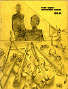
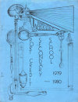
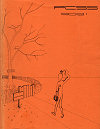
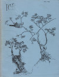

```{=html}
<section class="page-hero"><div class="shell"><p class="eyebrow">Recovered school documents</p><h1>Course calendars.</h1><p>Course calendar material preserved from the former alumni website.</p></div></section>

<div class="section shell prose recovered-content">
<section id="course-calendars" class="recovered-section"><h2>Course calendars</h2><p>  <strong>1978-79 Course Calendar</strong></p>
<p>A 61-page booklet (11MB PDF file) containing a list and description of the courses offered at PCSS for the 1978-79 school year.</p>
<p>  <strong>1979-80 Course Calendar</strong></p>
<p>A 57-page booklet (12MB PDF file) containing a list and description of the courses offered at PCSS for the 1979-80 school year.</p>
<p> <strong>1980-81Course Calendar</strong></p>
<p> A 64-page booklet (9MB PDF file) containing a list and description of the courses offered at PCSS for the 1980-81 school year.</p>
<p>  <strong>1981-82 Course Calendar</strong></p>
<p>A 69-page booklet (9MB PDF file) containing a list and description of the courses offered at PCSS for the 1981-82 school year.</p></section>
</div>
```
