```{=html}
<section class="page-hero"><div class="shell"><p class="eyebrow">Recovered event collections</p><h1>Alumni events.</h1><p>Alumni Nights, commencements and photographs preserved from the former alumni website.</p></div></section>

<div class="section shell prose recovered-content">
<section id="alumni-nights" class="recovered-section"><h2>Alumni Nights</h2><h3><span>PC Alumni Night, 06_05_16, The organizing committee</span></h3>
<p><span><strong>2016 Alumni Organizing Committee, taken at the Crooked Cue, the night of our Alumni Night. Special thanks to Susan Gibbins Events Coordinator/Photographer of THN Publications for the photo!</strong> <strong><br>
Pictured from Left (standing) Bruce Caton, Gary Branning, Bill Evans, Margo Mason, Dave Okamura, Christine Scott, Gerald Grant, Sandra Phillips, Gord Hatten, Jelena Vulic, Paul Lawrence. Front Row: Terry Hamm, Scott Lightfoot, Paul Walter</br></strong></span></p>
<p><span><strong>316 Alumnus</strong> strolled through the doors of the Crooked Cue at our 2016 Alumni Night and made the evening a complete success.</span></p>
<p>All proceeds from the Silent auction on Alumni Night wass used to help with the<br>
<a href="assets/recovered/events/PCSS-Design-Board3-6ba07227a4.pdf">Courtyard Renovation</a> project. Click on the link to see the plans.</br></p>
<h3>2016 Photos are ready for Viewing…… click here</h3>
<h3>For photos of Alumni nights from 2005-2015……</h3>
<h3>go to our Photo Page!</h3>
<h3><span>We made the SNAP MISSISSAUGA newspaper…. Check out the photos and story <span>here</span>.</span></h3>
<div><strong>2016:</strong> We made a major change in venue this year by heading to main street Port Credit and The Crooked Cue on Lakeshore. 316 Alumnus took in the new venue by storm. The evening was a complete success along with receiving over $4000.00 in total receipts including $800.00 in direct donations. We occupied the upper portion of the Cue and everyone raved at the setting and had a great time. We had a Silent Auction during the night along with a table of food and munchies that were worth the price of admission alone. Music played quietly in the background along with a slide show of over 2000 photos taken over the last 10 years at our events. We conducted a survey of how the Alumnus wanted our funds to be distributed which we have used to direct our monies accordingly. <strong>We plan to be back at the Cue for 2017!</strong></div>
<div></div>
<div><strong>2015:  </strong>This year back at the school we hosted a very special evening. We honored long time Teacher, coach and mentor Peter Martin. Many of his football players over the years returned to celebrate his many years at PCSS. 360 past students and teachers came out for this event as Peter was presented with a custom made jacket along with several speeches from past Alumnus. Proceeds from this event helped in purchasing the Bronze Bars for the Ontario Scholarship wall located across from the School Theatre.</div>
<div></div>
<div><strong>2014:</strong> At the Port Credit Legion this year we welcomed 147 people to the Alumni night. This year we were fortunate to have Gord Hatten provide us with an outstanding display of Port Credit memorabilia.</div>
<div></div>
<div><strong>2013:</strong> At the Port Credit Legion we added a live music jam session with Alumni grads taking part in an evening of music and song. 205 Alumni walked through the door that evening and fun, dancing and chatter was had by all.</div>
<div></div>
<div><strong>2012: </strong>This year we moved our Alumni night to the Legion in Port Credit. We lowered our costs by hosting outside the school and 217 Alumni turned out for the evening.</div>
<div></div>
<div><strong>2011: </strong>There were 190 paid attendees this year plus the AAC Committee. Proceeds of the evening funded the video display information center found in the front lobby near the office.</div>
<div></div>
<div>
<p><strong>2010:</strong> The 90th Reunion was celebrated over 3 days. Thursday we held Decade Nights and used several of of the Pubs and Bars on the Lakeshore in Port Credit. We held our Annual Pub Night on Friday night at the School. An open house and decade rooms were set up in the school and a talent show was performed by many band members. The attendance for the event topped 811 Alumnus. We capped off the celebration with a dinner dance at the Oasis in Lakeview for another 85 guests and Committee members.</p>
<p><strong>2009:</strong> 330 Alumnus attended this year, 1 year prior to our 90th!</p>
<p><strong>2008:</strong> This was a record year for Alumni Nights - 391 PCHS and PCSS graduates attended the Alumni Night this year, and the scholarship donations were $1465. The PCSS Alumni Committee wishes to thank all graduates for their generous contributions!</p>
<p><strong>2007:</strong> The attendance this year was 257 and the scholarship fund donations totaled $1450. Our thanks to everyone who made a contribution this year!</p>
<p><strong>2006:</strong> This year the 372 attendees generated approximately $3,600 in Alumni Night revenues and an additional $1,100 in actual Scholarship Donations. As a result, the Alumni Committee has decided to add an additional Scholarship Award to its program and also increase the amounts of both annual scholarships to $1,250.</p>
<p><strong>2005:</strong> The attendance this year was an impressive 312 people - a substantial increase over last year’s estimated 250. Alumni Night donations totaled $710 this year.</p>
<p><strong>2004:</strong> This year’s attendance is estimated to be about 250 people.</p>
<p><strong>2003:</strong> The attendance at this year’s Alumni Night was 270, including a considerable number of first-timers. Our graduates have demonstrated considerable generosity, as their donations to the Scholarship Fund (including the proceeds from the yearbook CDs) were over $2000.</p>
<p><strong>2002:</strong> The second annual PCSS Pub Night attracted 291 former students and teachers, beating last year’s attendance by more than fifty!</p>
<p><strong>2001:</strong> The attendance for the first annual PCSS Pub Night was 240 people. The funds raised during the annual PCSS Alumni Nights will provide financial support to other school enhancement programs. These programs will be chosen by the PCSS Students and the School Councils as essential for the school.</p>
</div>
<p> </p>
<div></div>
<p> </p>
<div></div>
<p> </p>
<h3></h3>
<h3></h3></section><section id="commencements" class="recovered-section"><h2>Commencements</h2><p>We are indebted to PCHS alumni Mary Atkinson and Jeanne (Miller) Rutherford, who very generously lent us their high school scrapbooks, along with many other items of interest. These Commencement programmes have been digitized from their collections, and are now available for all alumni to enjoy!</p>
<p></p>
<p>The <b>1936 Valedictorian speech</b>. This PDF file contains a scanned copy of the 1936 Valedictorian speech.</p>
<p></p>
<p>The <b>1948 Commencement Exercises programme</b>. This PDF file contains a scanned copy of the 1948 Commencement Excercises programme.</p>
<p></p>
<p>The <b>1962 Commencement Exercises programme</b>. This PDF file contains a scanned copy of the 1962 Commencement Excercises programme.</p>
<p></p>
<p>The <b>1970 Commencement Exercises programme</b>. This PDF file contains a scanned copy of the 1970 Commencement Excercises programme.</p>
<p></p>
<p>The <b>1984 Commencement Exercises programme</b>. This PDF file contains a scanned copy of the 1984 Commencement Excercises programme.</p></section><section id="photographs" class="recovered-section"><h2>Photo gallery</h2><p></p>
<p>Over many years of Alumni nights we have taken a a lot of photos. Please enjoy scanning<br>
through the years, you just might find yourself having fun!</br></p>
<p>If you have any photos to contribute please send them to Photos.</p>
<p>Please provide the year taken and the event with the photos.</p>
<h3>Alumni Nights 2005 - 2009</h3>
<table>
<tbody>
<tr>
<td>
<p><figure>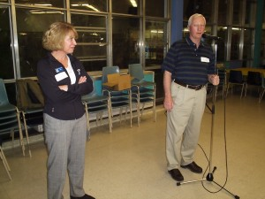<figcaption><b>2005 Alumni Night at the School</b></figcaption></figure></p></td>
<td>
<p><figure>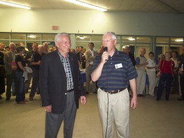<figcaption><b>2006 Alumni Night at the School</b></figcaption></figure></p></td>
</tr>
<tr>
<td>
<p><figure>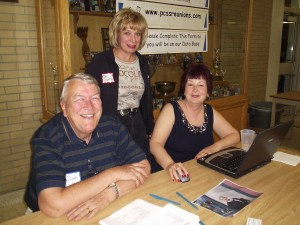<figcaption><b>2007 Alumni Night at the School</b></figcaption></figure></p></td>
<td>
<p><figure>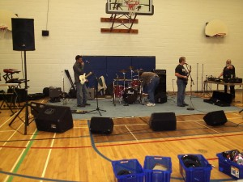<figcaption><b>2008 Alumni Night at the School</b></figcaption></figure></p></td>
</tr>
<tr>
<td>
<p><figure>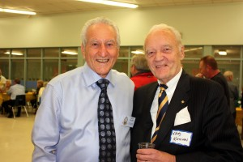<figcaption><b>2009 Alumni Night at the School</b></figcaption></figure></p></td>
<td></td>
</tr>
<tr>
<td colspan="3">
<h3><span><b>90th Anniversary photos (2010)</b></span></h3>
</td>
</tr>
<tr>
<td>
<p><figure>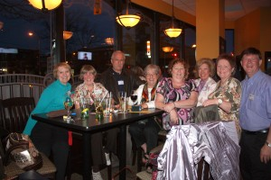<figcaption><b>2010 Decade Night<br> at Various Bars on the Lakeshore<b></b></br></b></figcaption></figure></p></td>
<td>
<p><figure>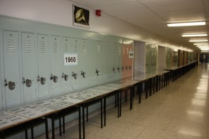<figcaption><b>2010 Alumni Night At the School</b></figcaption></figure></p></td>
</tr>
<tr>
<td>
<p><figure>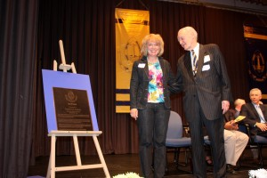<figcaption><b>2010 Welcoming Ceremonies<br> in the Auditorium at the School</br></b></figcaption></figure></p></td>
<td>
<p><figure>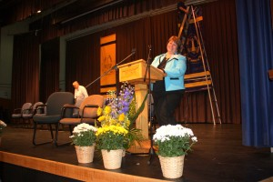<figcaption><b>2010 Open House at the School<b></b></b></figcaption></figure></p></td>
</tr>
<tr>
<td>
<p><figure>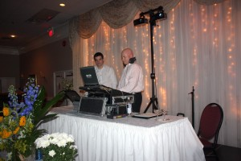<figcaption><b>2010 Gala Dance at the Oasis</b></figcaption></figure></p></td>
<td></td>
</tr>
</tbody>
</table>
<h3>Alumni Nights 2011 - 2016</h3>
<table>
<tbody>
<tr>
<td>
<p><figure>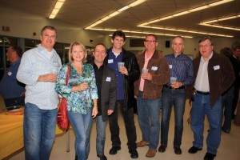<figcaption><b>2011 Alumni Night At the School</b></figcaption></figure></p></td>
<td>
<p><figure>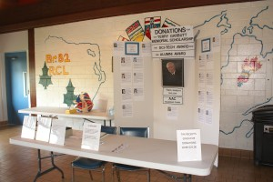<figcaption><b>2012 Alumni Night At the School<b></b></b></figcaption></figure></p></td>
</tr>
<tr>
<td>
<p><figure>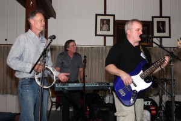<figcaption><b>2013 Alumni Night<br> At the Port Credit Legion</br></b></figcaption></figure></p></td>
<td>
<p><figure>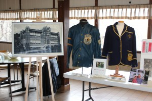<figcaption><b>2014 Alumni Night<br> at the Port Credit Legion</br></b></figcaption></figure></p></td>
</tr>
<tr>
<td>
<p><figure>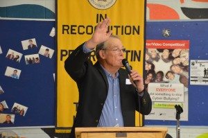<figcaption><b>2015 Alumni Night <br> at the School<br> Peter Martin Night</br></br></b></figcaption></figure></p></td>
<td>
<p><figure>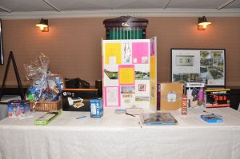<figcaption><b>2016 Alumni Night<br> at The Crooked Cue</br></b></figcaption></figure></p></td>
</tr>
</tbody>
</table></section>
</div>
```
