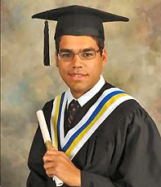

<section class="page-hero">

Supporting PCSS students
<h1>Scholarships.</h1>
Celebrating student achievement, leadership and service.

</section>

::: {.section .shell .prose}

## Alumni Association recipients

The scholarship programme began in 2001 with a $500 award. It grew to support university-bound, college-bound and community-leadership recipients.

<article id="andrew-andrade-2011" class="recipient-profile">

## Andrew Andrade, 2011

Andrew received the Alumni Association Scholarship for excellence and was the first recipient of the Terry Garbutt Memorial Award.

As a Science and Technology student, Andrew combined strong academics with badminton, ultimate Frisbee, lacrosse, student council, chess and chemistry clubs. He led the school’s Skills Ontario robotics team to the best result in Peel for two consecutive years, earning provincial finishes of fourth and sixth among more than 50 teams. His team also placed third at the McMaster Engineering Olympics, and he placed highly in the University of Waterloo computing competition.

The Terry Garbutt Memorial Award recognized Andrew’s creativity, initiative and leadership. He led a project that made Port Credit the first school in Canada to participate in IBM’s worldwide scientific computing grid. He developed the information technology infrastructure plan, assessed the costs to the school network and built the test lab used to establish the programme in two computer labs.

Andrew continued into Engineering at the University of Waterloo.

</article>

| Year | University or college recipients |
|---:|---|
| 2002 | Adrienne Kaminskyj |
| 2003 | Yusra Khan; Diane Blonski |
| 2004 | Tom McGee |
| 2005 | Robin Baj |
| 2006 | Vikram Somasundaram |
| 2007 | Robyn Williams |
| 2008 | Huda Al-Imari |
| 2009 | Diana Zuccarelli-Pegoraro; John Thomas |
| 2010 | Danielle Amirault; Jia Hui “Allen” Gou |
| 2011 | Bailey Izzard; [Andrew Andrade](#andrew-andrade-2011) |
| 2012 | Marina Welby; Riley Parratt |
| 2013 | Tiffany Dang; Victoria Ikeno |
| 2014 | Farah Hasan; Alnoor Gowani |
| 2015 | Molly Cowls; Shanice Hibbert |

## Terry Garbutt Memorial Scholarship

This award commemorated Alumni Association founder Terry Garbutt and recognized initiative, innovation and leadership in the school and community.

| Year | Recipient |
|---:|---|
| 2011 | [Andrew Andrade](#andrew-andrade-2011) |
| 2012 | Eric Zheng |
| 2013 | Sarah Walji |
| 2014 | Vishal Kuo |
| 2015 | Ruqaiyah Baksh |

## SciTech Scholarship

| Year | Recipient |
|---:|---|
| 2009 | Justin Brown; Nathan D’Souza |
| 2010 | Christopher Lomond |
| 2011 | Thai-Son Tang |

## Recipients, 2016 to 2024

Award categories are shown where they are available.

| Year | Recipients |
|---:|---|
| 2016 | Bryanna Manson (College); Joe Mattekatt (University); Laura Paradi (Terry Garbutt Memorial) |
| 2017 | Rohan Dadak (University); Sean Robinson (College); Zahra Hasan (Terry Garbutt Memorial) |
| 2018 | Jordan Hans (College); Jessica Tran and Kaitlyn Wilcox (University); Hareem Syed (Terry Garbutt Memorial) |
| 2019 | Hailey Wilson-Kay (College); Massa Mohamed Ali (University); Shrey Jain (Terry Garbutt Memorial) |
| 2020 | Recipient information is not currently available. |
| 2021 | Lauren Rowe; Natalya Grant; Vivek Bhadwaj |
| 2022 | Deven MacEwen-Daljit; Korly Regan; Swara Bangali |
| 2023 | Alexandra “Sasha” Pirner; Jackson Stumpf; Oliva Rose |
| 2024 | Hamza Soofi; Sara Markham; Sharon Kim |

:::

