```{=html}
<section class="page-hero"><div class="shell"><p class="eyebrow">Recovered school collections</p><h1>School life.</h1><p>Newspapers, productions and athletics material preserved from the former alumni website.</p></div></section>

<div class="section shell prose recovered-content">
<section id="newspapers" class="recovered-section"><h2>School newspapers</h2><div><div><div><div> <div><h4>Re:Port Credit</h4>
<p>Re:Port Credit was Port Credit Secondary School’s newspaper in the early and mid 1980s. It was published every two weeks, and was distributed free to the students. The first year (1980) was printed in-house using the school’s Gestetner machine. In the fall of 1980, it was outsourced to a local print shop called Willie’s Quick Print. These issues have been scanned from the personal collections of Craig Hughes (1982), Bob Yewchuk (1983) and Terry Lankstead (1985).</p>
</div>
</div></div></div><div><div><div><div><div>
<div>
<table>
<tbody>
<tr>
<td>Re:Port Credit cover page</td>
<td>Re:Port Credit cover page</td>
<td>Re:Port Credit cover page</td>
<td>Re:Port Credit cover page</td>
<td>Re:Port Credit cover page</td>
<td>Re:Port Credit cover page</td>
<td>Re:Port Credit cover page</td>
<td>Re:Port Credit cover page</td>
</tr>
<tr>
<td>Apr 3, 1980</td>
<td>Apr 25, 1980</td>
<td>May 16, 1980</td>
<td>Jun 5, 1980</td>
<td>Sep 26, 1980</td>
<td>Oct 10, 1980</td>
<td>Oct 24, 1980</td>
<td>Nov 7, 1980</td>
</tr>
<tr>
<td>Re:Port Credit cover page</td>
<td>Re:Port Credit cover page</td>
<td>Re:Port Credit cover page</td>
<td>Re:Port Credit cover page</td>
<td>Re:Port Credit cover page</td>
<td>Re:Port Credit cover page</td>
<td>Re:Port Credit cover page</td>
<td>Re:Port Credit cover page</td>
</tr>
<tr>
<td>Nov 21, 1980</td>
<td>Dec 18, 1980</td>
<td>Jan 16, 1981</td>
<td>Jan 30, 1981</td>
<td>Feb 13, 1981</td>
<td>Feb 27, 1981</td>
<td>Apr 10, 1981</td>
<td>Apr 24, 1981</td>
</tr>
<tr>
<td>Re:Port Credit cover page</td>
<td>Re:Port Credit cover page</td>
<td>Re:Port Credit cover page</td>
<td>Re:Port Credit cover page</td>
<td>Re:Port Credit cover page</td>
<td>Re:Port Credit cover page</td>
<td>Re:Port Credit cover page</td>
<td>Re:Port Credit cover page</td>
</tr>
<tr>
<td>May 8, 1981</td>
<td>May 22, 1981</td>
<td>Jun 5, 1981</td>
<td>Sep 25, 1981</td>
<td>Oct 30, 1981</td>
<td>Nov 13, 1981</td>
<td>Dec 18, 1981</td>
<td>Jan 29, 1982</td>
</tr>
<tr>
<td>Re:Port Credit cover page</td>
<td>Re:Port Credit cover page</td>
<td>Re:Port Credit cover page</td>
<td>Re:Port Credit cover page</td>
<td>Re:Port Credit cover page</td>
<td>Credit Camera</td>
<td>Re:Port Credit cover page</td>
<td>Re:Port Credit cover page</td>
</tr>
<tr>
<td>Feb 12, 1982</td>
<td>Apr 16, 1982</td>
<td>May 7, 1982</td>
<td>May 21, 1982</td>
<td>Sep 24, 1982</td>
<td>Oct 29, 1982</td>
<td>Nov 26, 1982</td>
<td>Jan 7, 1983</td>
</tr>
<tr>
<td>Re:Port Credit cover page</td>
<td>Re:Port Credit cover page</td>
<td>Credit Camera</td>
<td>Re:Port Credit cover page</td>
<td>Re:Port Credit cover page</td>
<td>Re:Port Credit cover page</td>
<td>Re:Port Credit cover page</td>
<td>Credit Camera</td>
</tr>
<tr>
<td>Feb 25, 1982</td>
<td>Mar 29, 1983</td>
<td>May 27, 1982</td>
<td>Sep 30, 1983</td>
<td>Oct 28, 1983</td>
<td>Nov 25, 1983</td>
<td>Dev 16, 1983</td>
<td>Apr 19, 1984</td>
</tr>
<tr>
<td>Re:Port Credit cover page</td>
<td>Re:Port Credit cover page</td>
<td>Re:Port Credit cover page</td>
<td>Re:Port Credit cover page</td>
<td>Credit Camera</td>
</tr>
<tr>
<td>Jun 1, 1984</td>
<td>Oct 1984</td>
<td>Dec 1984</td>
<td>Apr 1985</td>
<td>Credit Camera</td>
</tr>
</tbody>
</table>
</div>
</div></div></div></div></div></div></section><section id="plays" class="recovered-section"><h2>School plays</h2><p>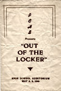</p>
<p>1946 Programme - Out Of The Locker.</p>
<p>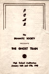</p>
<p>1948 Programme - The Ghost Train.</p>
<p>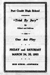</p>
<p>1950 Programme - Trial By Jury.</p>
<p>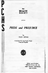</p>
<p>1951 Programme - Pride And Prejudice.</p>
<p>1968 Rhinoceros</p>
<p>1968 Programme - Rhinoceros.</p>
<p>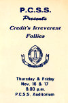</p>
<p>1972 Programme - Port Credit’s Irreverent Follies.</p>
<p>1978 The Boyfriend</p>
<p>1978 Programme - The Boyfriend.</p>
<p>We are indebted to PCHS alumni Mary Atkinson, Sandy Mattice and Jeanne Miller Rutherford, who very generously lent us their high school scrapbooks, along with many other items of interest. Most of these play and concert programmes (the ones from the 1930s, 1940s, 1950s and 1960s) have been digitized from their collections, and are now available for all alumni to enjoy!</p>
<h4>1935 Play: Campbell Of Kilmhor</h4>
<p>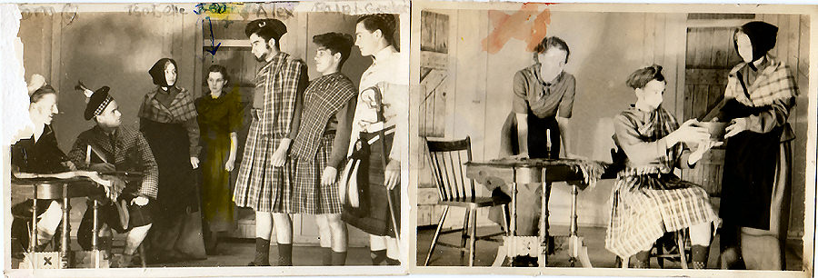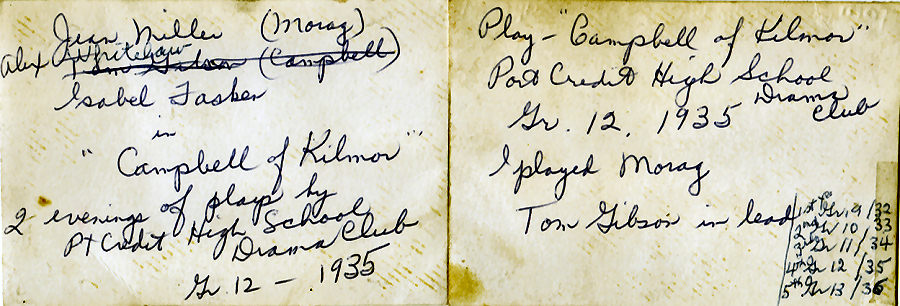<br>
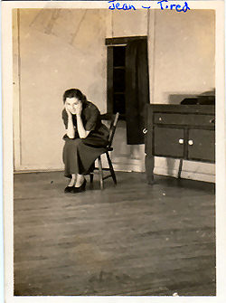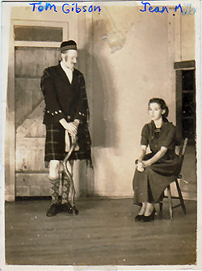<br>
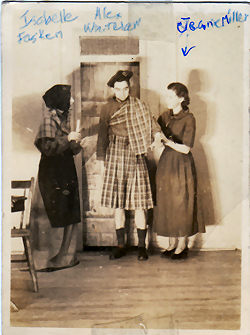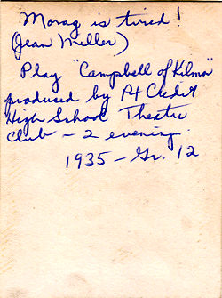<br>
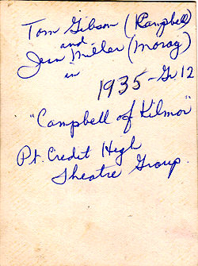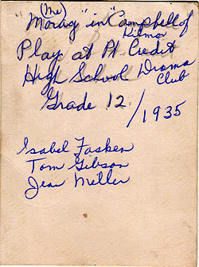</br></br></br></p>
<h4>An Evening of Plays, Songs and Dances: 1935</h4>
<p>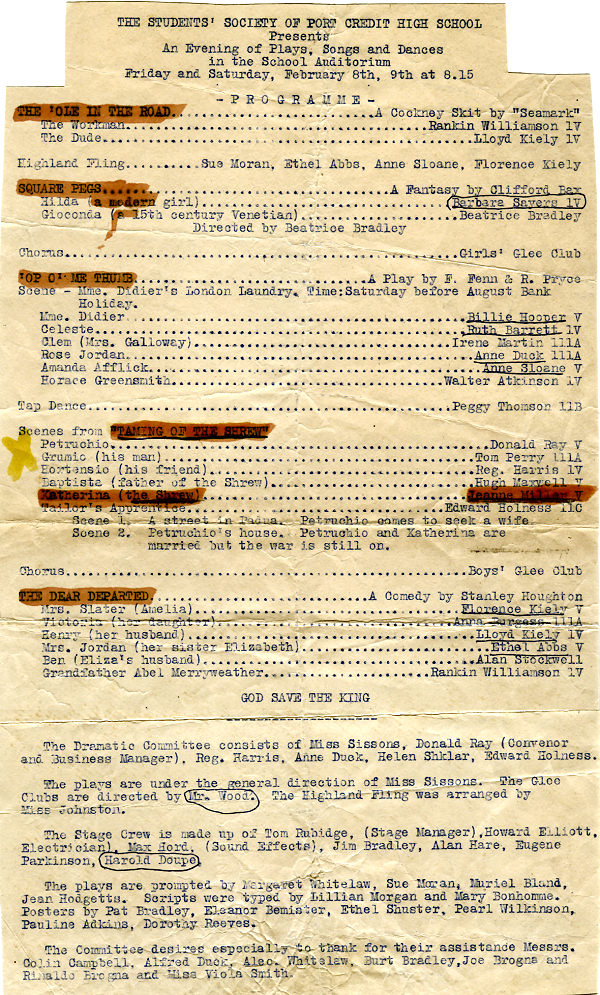</p>
<h4>1936 Play: The Taming Of The Shrew</h4>
<p>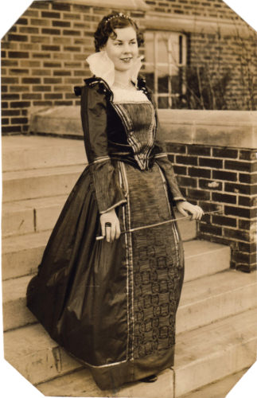<br>
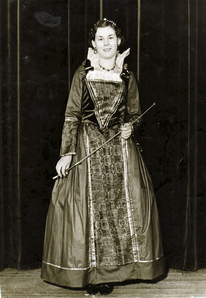</br></p>
<p>Jeanne Miller, on the front steps of Port Credit High School, in costume of “Katherine” from The Taming Of The Shrew, May 1936. Photos taken by the Toronto Telegram newspaper.</p>
<h2>A Request For Archival Material</h2>
<p>We’re looking for PCSS packrats! If you’ve saved any items from your high school days which you feel would make a worthwhile addition to this web site - photographs, music concert programmes, school newspapers, local newspaper articles about our school etc. - then please contact us so that we can make arrangements to borrow and digitize them. We will treat your submissions with the utmost care, and return them to you in the same condition.</p></section><section id="athletics" class="recovered-section"><h2>Athletics</h2><h4>1948 Western Conference Co-Champions, Semi-Finalists</h4>
<p>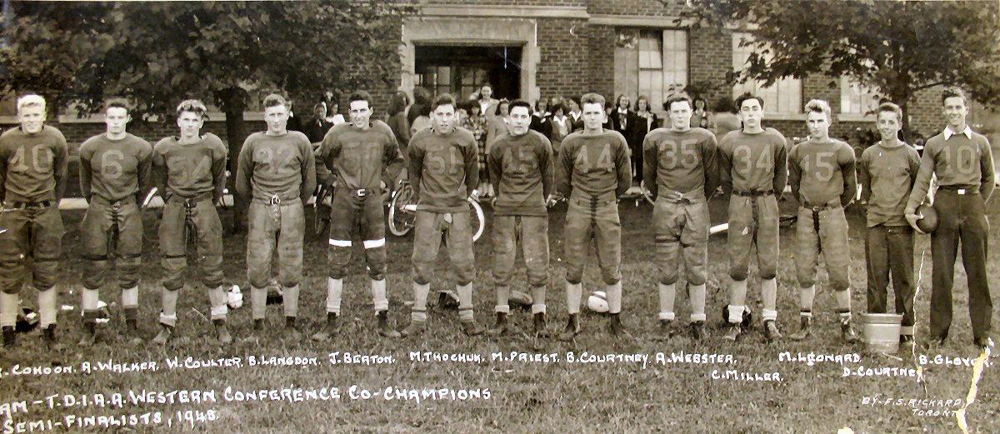</p>
<p><b>(L-R):</b> B. Cohoon, A. Walker, W. Coulter, B. Langdon, J. Beaton, M. Tkochuk, M. Priest, B. Courtney, A. Webster, C. Miller, M. Leonard, D. COurtney, B. Gloyer.</p>
<p><span>For a full PDF version of the 1948 photo click here</span></p>
<h4>1967 Junior A Football Champions T.T.S.S.A.A.</h4>
<p>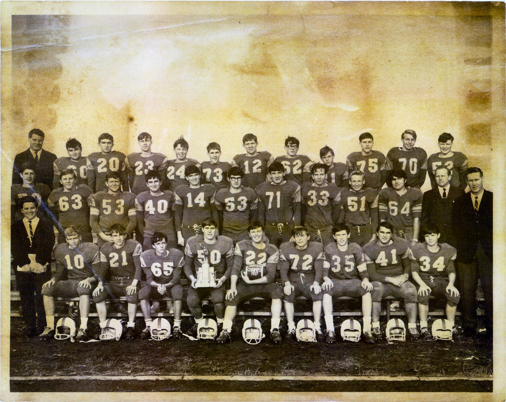</p>
<p><span>For a full PDF version of the 1967 photo click here</span></p>
<p>“After nearly 45 years, it is difficult to remember many details of this particular football game. I know we played Lorne Park Secondary School. Checking a yearbook tells me that the game was played on November 9. I remember it being a cold, damp, cloudy autumn afternoon. Tom Boaz caught a pass from quarterback John Raynor for the winning touchdown. I was punched in the stomach by a Lorne park player in a gesture of good sportsmanship when it became clear they were going to lose. Sadly, our quarterback John Plaxton (#12), was to die in a car accident four months later, along with three other Port Credit students.”  -  Chris McGann (#20)</p>
<p><b>Back Row (L-R):</b> Mr. Powell, Ed Sandford, Chris McGann, Tom Boaz, Bob Schott, Tom Newitt, John Plaxton, Jerry Fullerton, Curt Smith, Bob Boaz, Fred Davis, Dave Clare.<br>
<b>Middle Row (L-R):</b> Jeff Derbyshire, Jim Laird, Bill Weller, Jim Schoenhardt, John Rayner, John Frittenbourg, Renis Ryke, Chris Garner, Fred Lazar, Mr. Renton.<br>
<b>Fromt Row (L-R):</b> Derek Elliot, Mike Sills, Steve Legault, Bill Semple, Greg Lucas, Ron Schott, John Stackwell, Rick Block, Russ Sawchuk, Skip Izon, Mr. Brown.</br></br></p>
<p> </p></section>
</div>
```
